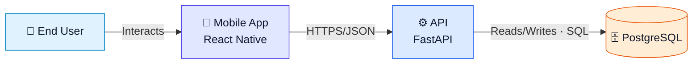

# Visual Language

Use a hybrid of colorful teaching clarity and enterprise architecture discipline.

## Semantic palette

| Category | Fill / Border | Meaning |
|---|---|---|
| Actors | `#E0F2FE` / `#0284C7` | Human actors |
| Frontend/client | `#E0E7FF` / `#4F46E5` | Web/mobile/desktop clients |
| Backend/service | `#DBEAFE` / `#2563EB` | APIs/application services |
| AI/ML | `#F3E8FF` / `#9333EA` | Models/AI/retrieval |
| Data | `#FFEDD5` / `#EA580C` | DB/storage/cache |
| Queue/async | `#FEF3C7` / `#D97706` | Queues/events/jobs |
| Auth/security | `#FEE2E2` / `#DC2626` | Identity/security |
| Infrastructure | `#CCFBF1` / `#0F766E` | Cloud/runtime infra |
| CI/CD | `#DCFCE7` / `#16A34A` | Build/deploy |
| Observability | `#FCE7F3` / `#DB2777` | Logs/metrics/analytics |
| External | `#F1F5F9` / `#64748B` | Third-party systems |

Color is never the only carrier of meaning. Use descriptive node labels and named boundaries. Do not add color legends or color-key panels.

## Portable icons

Use recognizable portable icons when vendor icon packs are unavailable:

`👤` actor · `📱` mobile · `🌐` web · `🖥️` desktop · `⚙️` service · `🧩` module · `🧠` AI · `🗄️` DB · `💾` storage/cache · `📨` queue · `🔐` auth · `☁️` infra · `🔌` external API · `🔔` notifications · `📈` observability · `🚀` CI/CD · `🧪` tests/evals.

## Relationships

Every meaningful line has a label. Prefer specific labels such as:
- `Calls API · HTTPS/JSON`
- `Publishes job · SQS`
- `Reads/Writes · PostgreSQL`
- `Validates token · JWT/JWKS`

Avoid unlabeled arrows or generic `uses`.

Recommended line semantics:
- solid: synchronous request/control;
- dashed: asynchronous event/message;
- dotted: build/deploy/observability/control-plane.

Label relationships directly so their meaning is clear without a legend.

## Boundaries

Use subgraphs/groups for ownership, subsystem, trust zone, runtime environment, cloud/VPC, and external providers. Label what each boundary means.

## Labels

Deep diagrams: icon + name + technology + one short responsibility line when useful.
Overview: keep labels concise.

## Layout

Prefer users/clients left/top, core center, data/infra lower/right, external providers right, CI/CD separate/above, workers near queues. Deviate if that reduces crossings.

## Congestion

Split when labels shrink, central crossings accumulate, a hub becomes unreadable, deployment/runtime concerns compete, or internals obscure the top-level story. Never solve congestion with tiny text.

## C4-inspired discipline

Use context for people/systems, container for apps/services/stores, component only where useful, and deployment separately when environment detail matters.

## Mermaid

Prefer `flowchart LR` or `flowchart TB` for portable controllable diagrams. Use `subgraph`, semantic `classDef`, explicit IDs, concise labels, and sparing ` `.

Example:

Every diagram must remain understandable without a long narrative.
