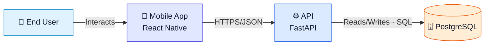

# Visual Language

Default to a compact, icon-led infographic: white background, one coral/rose accent (for example `#F73562`), recognizable monochrome pictograms, short labels beneath icons, and a clear visual flow. Honor user-supplied styles. Treat reference images as visual direction, never evidence for the project's components or connections.

## Reference-style composition

- Prefer open icon-and-label nodes over large filled cards. Use a coherent outline or solid icon family; circles may anchor actors and outcomes.
- Use a generous canvas (normally at least 1200 px wide), consistent icon size and stroke weight, and labels readable at the intended display size. Keep labels to two short lines when practical; put detail in accompanying documentation.
- Route flows left to right; use a second row only when arrowheads make the reading order unambiguous. Keep branches separated and avoid crossings or connectors running through labels.
- Use the accent for icons and connectors. Use darker text when the accent lacks sufficient contrast at small sizes. Avoid gradients, shadows, decorative panels, and color legends by default.
- Small connector dots may echo a reference, but must not resemble extra nodes or obscure arrowheads. Preserve solid/dashed semantics and explicit labels where needed.
- Preserve ownership/trust boundaries when material. Mark inferred elements in text; color alone cannot encode confidence.
- Do not copy a reference's overlapping labels, tiny typography, or unsupported pipeline steps.

## Producing the presentation image

Mermaid remains the portable architecture source and its rendered SVG remains required. Its layout and icon support may not reproduce an icon-led infographic faithfully.

For overview mode, also create `diagrams/project-overview-infographic.svg`: an editable, self-contained vector composition from the same architecture model. For deep mode, make a companion only for views that benefit from this treatment or when requested. Use native SVG paths, shapes, and text with a viewBox; keep labels as text and include a title and description. Use locally available licensed icons or simple authored pictograms, with no remote fonts, images, scripts, or external asset dependencies. Keep model IDs on component groups and relationship elements to help cross-check fidelity.

The companion is a restyling of the same view, not an extra architecture view. Preserve its components, relationships, directions, confidence, and meaningful boundaries. Embed it prominently in the overview document and link the portable diagram alongside it. If PNG export is available, also export a high-resolution PNG for sharing while retaining the SVG. Never substitute a raster illustration for the evidence-backed diagram.

Render and visually inspect the companion at intended display size, compare it to the model, and record its verification separately. If tools cannot render or inspect it, report that limitation rather than claiming visual verification. Do not silently replace a renderer-produced SVG with a hand-authored companion.

## Optional multicolor palette

| Category | Fill / Border | Meaning |
|---|---|---|
| Actors | `#E0F2FE` / `#0284C7` | Human actors |
| Frontend/client | `#E0E7FF` / `#4F46E5` | Web/mobile/desktop clients |
| Backend/service | `#DBEAFE` / `#2563EB` | APIs/application services |
| AI/ML | `#F3E8FF` / `#9333EA` | Models/AI/retrieval |
| Data | `#FFEDD5` / `#EA580C` | DB/storage/cache |
| Queue/async | `#FEF3C7` / `#D97706` | Queues/events/jobs |
| Auth/security | `#FEE2E2` / `#DC2626` | Identity/security |
| Infrastructure | `#CCFBF1` / `#0F766E` | Cloud/runtime infra |
| CI/CD | `#DCFCE7` / `#16A34A` | Build/deploy |
| Observability | `#FCE7F3` / `#DB2777` | Logs/metrics/analytics |
| External | `#F1F5F9` / `#64748B` | Third-party systems |

Color is never the only carrier of meaning. Use descriptive node labels and named boundaries. Do not add color legends or color-key panels.

## Optional emoji fallback

Only when a multicolor style is requested or acceptable, use recognizable portable icons:

`👤` actor · `📱` mobile · `🌐` web · `🖥️` desktop · `⚙️` service · `🧩` module · `🧠` AI · `🗄️` DB · `💾` storage/cache · `📨` queue · `🔐` auth · `☁️` infra · `🔌` external API · `🔔` notifications · `📈` observability · `🚀` CI/CD · `🧪` tests/evals.

## Relationships

Every meaningful line has a label. Prefer specific labels such as:
- `Calls API · HTTPS/JSON`
- `Publishes job · SQS`
- `Reads/Writes · PostgreSQL`
- `Validates token · JWT/JWKS`

Avoid unlabeled arrows or generic `uses`.

Recommended line semantics:
- solid: synchronous request/control;
- dashed: asynchronous event/message;
- dotted: build/deploy/observability/control-plane.

Label relationships directly so their meaning is clear without a legend.

## Boundaries

Use subgraphs/groups for ownership, subsystem, trust zone, runtime environment, cloud/VPC, and external providers. Label what each boundary means.

## Labels

Deep diagrams: icon + name + technology + one short responsibility line when useful.
Overview: keep labels concise.

## Layout

Prefer users/clients left/top, core center, data/infra lower/right, external providers right, CI/CD separate/above, workers near queues. Deviate if that reduces crossings.

## Congestion

Split when labels shrink, central crossings accumulate, a hub becomes unreadable, deployment/runtime concerns compete, or internals obscure the top-level story. Never solve congestion with tiny text.

## C4-inspired discipline

Use context for people/systems, container for apps/services/stores, component only where useful, and deployment separately when environment detail matters.

## Mermaid

Prefer `flowchart LR` or `flowchart TB` for portable controllable diagrams. Use `subgraph`, consistent `classDef`, explicit IDs, concise labels, and sparing ` `. For the default style, use white fills and the same accent stroke across categories. The example below illustrates the optional multicolor style.

Example:

Every diagram must remain understandable without a long narrative.
